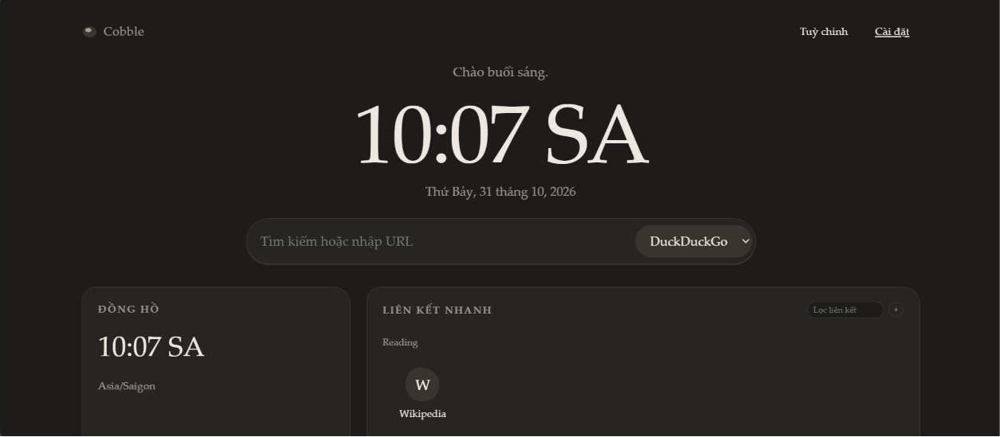
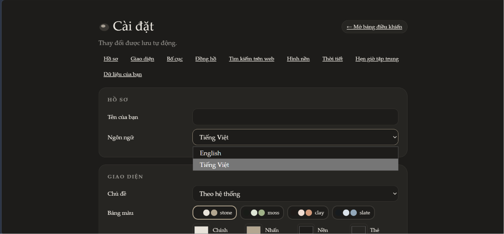

# Cobble

A simpler, more personal browsing experience.

[](https://github.com/neotwis/cobble)
[](LICENSE)

## Download

<p align="left">
  <a href="https://microsoftedge.microsoft.com/addons/detail/cobble/lgflemjobmkkklccegfggpejiojolmpe">
    
  </a>
  <a href="https://addons.mozilla.org/vi/firefox/addon/cobble/">
    
  </a>
</p>

**Google Chrome:** Follow the manual installation guide below.

## Preview





## Features

- Personalized browsing dashboard
- Quick links to your favorite websites
- Bookmark management
- Built-in notes
- Pomodoro timer
- Custom themes, colors and wallpapers
- Multiple layouts
- English and Vietnamese language support
- Local data storage

## Supported Browsers

| Browser | Support |
|---|---|
| Google Chrome | Manual installation |
| Microsoft Edge | Available |
| Mozilla Firefox | Available |
| Brave | Compatible |

## Installation

### Google Chrome

1. Download the [Cobble ZIP file](https://github.com/neotwis/cobble/archive/refs/heads/main.zip).
2. Open your Downloads folder and locate `cobble.zip`.
3. Extract the ZIP file.
4. Open Chrome and visit `chrome://extensions/`.
5. Enable **Developer mode** in the top-right corner.
6. Click **Load unpacked**.
7. Select the extracted `cobble` folder containing `manifest.json`.

Cobble will now appear in your Chrome extensions.

### Microsoft Edge

1. Visit the [Microsoft Edge Add-ons Store](https://microsoftedge.microsoft.com/addons/detail/cobble/lgflemjobmkkklccegfggpejiojolmpe).
2. Click **Get** to install Cobble.

### Mozilla Firefox

1. Visit the [Firefox Add-ons Store](https://addons.mozilla.org/vi/firefox/addon/cobble/).
2. Click **Add to Firefox**.

## Tech Stack

- WebExtensions API

## Development

Clone the repository:

```bash
git clone https://github.com/neotwis/cobble.git
cd cobble
```

Install dependencies:

```bash
npm install
```

Start the development server:

```bash
npm run dev
```

Build the extension:

```bash
npm run build
```

## Privacy

Cobble is designed with privacy in mind. Personal settings and data are stored locally whenever possible.

## Developer

Developed by **[neotwis](https://github.com/neotwis)**.

## License

This project is licensed under the [MIT License](LICENSE).